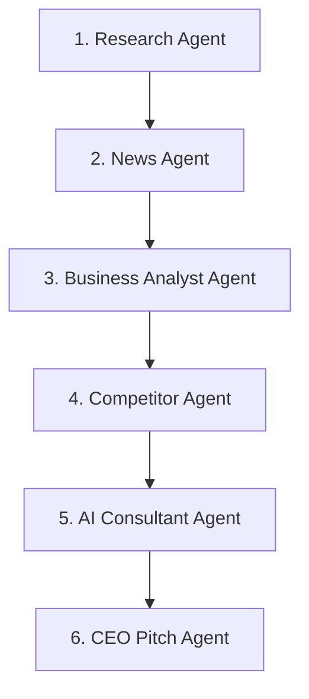

# AURA BI: AI Business Intelligence & Research Consultant Platform

AURA BI is a production-quality, multi-agent AI platform that accepts a company name as input, crawls and researches its profile from the web, and generates an interactive, high-fidelity corporate intelligence dashboard.

It includes SWOT quadrants, competitor benchmarking matrices, financial/ROI forecasts, and a direct memo pitch addressed to the CEO.

---

## 🛠️ Technology Stack

### Backend
- **FastAPI / Uvicorn**: Lightweight high-performance REST API.
- **LangGraph / LangChain**: Coordinates the 6-agent collaborative swarm.
- **Pydantic**: Structural schema validation and JSON serialization.
- **ReportLab**: Dynamic generation of corporate PDF reports.
- **python-pptx**: Dynamic export of dark-themed PowerPoint presentations.
- **APIs**: Tavily (Web search), Google Gemini (via `langchain-google-genai`) or OpenAI (via `langchain-openai`).

### Frontend
- **React 18 / Vite / TypeScript**: Frontend compiler and component environment.
- **Tailwind CSS**: Custom glassmorphism variables, dark/light mode styles.
- **Framer Motion**: Smooth entrance transitions, stepper animations, and hover rotation effects.
- **Recharts**: Responsive area, bar, and pie charts.
- **Lucide Icons**: SVG vector iconography.

---

## 🤖 Multi-Agent Swarm Architecture

The analysis is performed by six independent, specialized agents executed sequentially using a **LangGraph state graph**:



1. **Research Agent**: Crawls core facts, headquarters, leadership, products, and financials.
2. **News Agent**: Discovers recent product launches, mergers, acquisitions, and expansions.
3. **Business Analyst Agent**: Evaluates internal weaknesses and external market threats (SWOT).
4. **Competitor Agent**: Compares the company with top sector peers, sizing up products and tech stacks.
5. **AI Consultant Agent**: Proposes 3 concrete, ROI-driven AI opportunities to solve operational bottlenecks.
6. **CEO Pitch Agent**: Formulates a personalized executive summary memo addressed directly to the C-suite.

---

## 💡 Hybrid Execution Modes

To ensure the platform is robust and instantly evaluatable:
1. **Live Agent Mode**: Activated by placing `GEMINI_API_KEY` (or `OPENAI_API_KEY`) and `TAVILY_API_KEY` in the `backend/.env` file. It executes live web searches and processes real-time LLM structured outputs.
2. **Dynamic Demo Mode**: If no API keys are provided, the system falls back to a smart simulated engine that builds realistic, customized report models dynamically for any searched company based on its industry profile, with high-fidelity presets for popular targets like Stripe, Tesla, Nvidia, Apple, and SpaceX.

---

## 🚀 Installation & Running Guide

Ensure you have **Node.js (v20+)** and **Python (3.10+)** installed.

### 1. Backend Setup
1. Navigate to the `backend` directory:
   ```bash
   cd backend
   ```
2. Initialize virtual environment:
   ```bash
   python -m venv .venv
   .venv\Scripts\activate
   ```
3. Install dependencies:
   ```bash
   pip install -r requirements.txt
   ```
4. Copy the environment template and set your API keys:
   ```bash
   cp .env.example .env
   ```
5. Run the FastAPI development server:
   ```bash
   python run.py
   ```
   *The backend will run on `http://127.0.0.1:8000`.*

### 2. Frontend Setup
1. Navigate to the `frontend` directory:
   ```bash
   cd ../frontend
   ```
2. Install npm dependencies:
   ```bash
   npm install
   ```
3. Run the Vite development server:
   ```bash
   npm run dev
   ```
   *The frontend application will boot on `http://localhost:5173`.*

---

## 📦 Features Highlight
- **Company Search**: Triggers active multi-agent loader sequence tracking steps.
- **SWOT Quadrants Grid**: Beautiful grid containing categorized strategic metrics.
- **Benchmarking Table**: Compares competitor revenue, employees, products, and weaknesses.
- **AI Opportunity Matrices**: Analyzes implementation costs, complexity, timeline, and ROI.
- **Interactive Recharts**: Renders cumulative forecasts, expense ratios, and share splits.
- **CEO Memo Box**: Formal brief with letterhead, date-code references, and signature blocks.
- **One-click Exports**: Downloads standard PDF report or widescreen PowerPoint deck directly from memory.
- **Copy/Share Integrations**: Animated alerts showing clipboard status.
